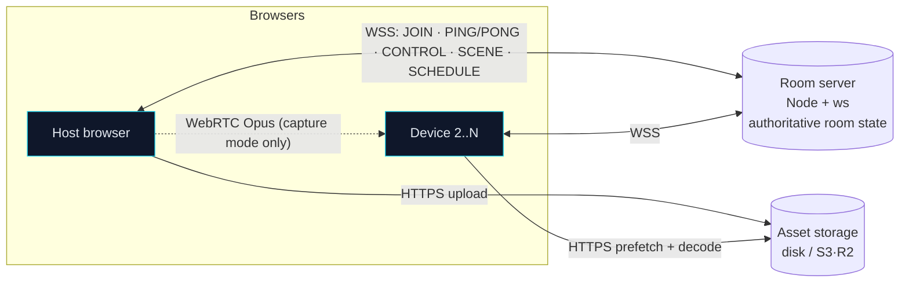

# SyncSound

Turn every phone, laptop and tablet in the room into one synchronized surround-sound system, right in the browser.
A host creates a room, everyone joins by link or QR code, and every device plays the same audio at the same
instant. Each device renders its **own spatial mix** with automatic latency compensation and per-device EQ.

```bash
pnpm install && pnpm demo && pnpm dev     # web http://localhost:3000 · server :8787
```

Open the web URL, **Create a room**, then open the join link in another tab/browser/phone and press
**Join the speaker array**. Queue a demo track (click track, 5.1 test, synth groove) and press play. Drag the
sound objects around the **Stage**.

> Ports busy? `SERVER_PORT=8788 WEB_PORT=3200 pnpm dev` (the web app follows `SERVER_PORT` automatically). Phones on your LAN: open `http://<your-LAN-IP>:3000`. Playback works
> over plain HTTP; **calibration (mic) and tab capture need HTTPS** (see [docs/DEPLOY.md](docs/DEPLOY.md)).

## Features

- **Rooms:** short unguessable codes, QR plus share link, optional password, host-only control, auto-expiry.
- **Sync:** NTP-style clock sync over WebSocket, drift tracking, `AudioContext`-clock scheduling, `playbackRate`
  drift correction, late joiners land on the running timeline.
- **Sources (Class A, full features):** demo tracks, uploads (audio/video, incl. 5.1 WAV), URLs you have rights
  to, live **tab/system capture** (WebRTC) for YouTube and video, and **local video** with the picture locked to
  the room clock.
- **Sources (Class B, sync-only):** Spotify (Web Playback SDK, Premium) and Apple Music (MusicKit JS). DRM means
  no spatial/EQ, and the UI says so.
- **Spatial stage:** draggable devices, listener and audio objects (L/C/R/SL/SR/LFE/ambience/stems); DBAP panning
  with constant power; LR4 bass management to bass-capable devices; propagation time-alignment; presets;
  undo/redo; snap; keyboard control.
- **One-tap tune:** from the seat, every speaker plays one swoosh → chime while every laptop listens (each asked
  for its mic once, at join): distances → positions, timing aligned at the head, loudness matched to the median,
  frequency response → auto-EQ toward a common target with safety rails. The compensation is re-derived by the
  server from the raw arrivals, so rearranging the picture never breaks the timing; every screen says who is tuned,
  who needs tuning again and why. Device-class presets cover the no-mic case. Includes EQ A/B, a click-test mode
  for tuning by ear, and a **sync-measurement tool** with a histogram.
- **Debug drawer:** clock offset, RTT, jitter, drift ppm, per-device error and buffer states.
- PWA, dark accessible UI (Lighthouse a11y 100), responsive down to 360 px.

## Architecture



```
apps/web/            Next.js App Router · Tailwind · Zustand — UI, Web Audio engine, WebRTC mesh, SDK adapters
apps/server/         Node + ws — transport-free Room (Durable-Object-portable), uploads, rate limits
packages/protocol/   zod schemas for every message (shared types)
packages/audio-core/ pure TS: clock sync, scheduler, drift control, spatial gains, biquads/LR4, FFT, sweeps,
                     chirp detection, EQ fitting, calibration + sync-measurement analysis, WAV I/O
packages/sim/        network/clock simulator, offline-render alignment (node-web-audio-api), acoustic sims
e2e/                 Playwright: multi-context rooms, loopback-mic calibration, capture, video, remote, a11y
```

## How the sync works

1. **One room clock.** The server's clock is the room clock. Each client sends `PING {t0}`; the server answers
   `PONG {t0, ts_recv, ts_send}`. Per exchange: `rtt = (t3−t0) − (ts_send−ts_recv)`,
   `offset = ((ts_recv−t0) + (ts_send−t3)) / 2`. A 25-ping burst at join, then 1 Hz. Over a 64-sample window it
   takes the **median offset of the lowest-RTT 25 %**, fits a robust drift slope (ppm), and **slews** corrections
   (≤ 1 ms/s) instead of stepping.
2. **Audio clock mapping.** `AudioContext.getOutputTimestamp()` gives (context time, performance time) pairs for
   when audio is actually *heard*, so browser-reported output latency is built in. A robust linear fit maps
   `roomTime ↔ performance.now() ↔ AudioContext.currentTime`, and detects output-path latency steps (device
   re-open, Bluetooth profile switch) without bending the slope.
3. **Future-dated commands.** Play/pause/seek become `SCHEDULE {startRoomTime, trackOffset}` at least
   `max(device RTT) + 150 ms` in the future. Every device has already downloaded and decoded the asset. It calls
   `source.start(when, offset)` with `when = roomToCtx(startRoomTime) − compensation`, snapped to the sample grid.
   A late joiner jumps straight to the correct offset.
4. **Compensation** = manual trim + acoustic calibration (relative output latency, e.g. Bluetooth) + browser
   latency (when no output timestamp) − propagation alignment, which delays nearer speakers so sound from every
   speaker reaches the listener together.
5. **Drift correction** every 500 ms: error under 2 ms → nothing; 2–30 ms → nudge `playbackRate` by up to ±0.2 %
   (inaudible); over 30 ms → crossfaded reschedule.
6. **Each device renders only its own mix** from the shared scene: DBAP gains (Σg² = 1) for its position, a bass
   send, high-pass, EQ, limiter and trim, with gains smoothed via `setTargetAtTime`.

Measured (simulated or headless) numbers are in [docs/SYNC_RESULTS.md](docs/SYNC_RESULTS.md): sub-ms clock error on
LAN, p95 2.6 ms under harsh jitter, 0.69 ms rendered inter-device alignment, a Bluetooth 195 ms latency recovered
to ±0.01 ms, and 0.11 ms predicted heard-instant spread across real browser contexts.

## Commands

| Command | What |
|---|---|
| `pnpm dev` | server :8787 + web :3000 (`SERVER_PORT` / `WEB_PORT` to change) |
| `pnpm demo` | generate demo WAVs (click track, sweep, stereo, 5.1 test, synth groove) |
| `pnpm test` | unit tests (vitest) |
| `pnpm sim` | headless simulator suite (clock, drift, render alignment, calibration, remote sync) |
| `pnpm e2e` | Playwright end-to-end (builds the web app, starts both servers) |
| `pnpm typecheck` / `pnpm lint` | strict TS / ESLint |
| `pnpm verify` | typecheck + lint + test + sim + demo + e2e: the single green/red gate |

## Configuration

Copy `.env.example`. Everything is optional; the app runs fully without credentials.

| Variable | For |
|---|---|
| `NEXT_PUBLIC_SERVER_URL` | server URL the browser uses (default `<page host>:8787`) |
| `NEXT_PUBLIC_SPOTIFY_CLIENT_ID`, `NEXT_PUBLIC_SPOTIFY_REDIRECT_URI` | Spotify sync-only mode (Premium per device) |
| `NEXT_PUBLIC_APPLE_MUSIC_DEVELOPER_TOKEN` | Apple Music sync-only mode (subscription per device) |
| `PORT`, `DATA_DIR`, `ALLOWED_ORIGINS`, `ROOM_TTL_MINUTES`, `PUBLIC_URL` | server (`ALLOWED_ORIGINS` is comma-separated; `*` matches one hostname fragment, e.g. `https://web-*-team.vercel.app`) |
| `S3_BUCKET`, `S3_ENDPOINT`, `S3_REGION`, `S3_ACCESS_KEY_ID`, `S3_SECRET_ACCESS_KEY`, `S3_PUBLIC_BASE_URL` | S3/R2/MinIO uploads |

## Docs

- [docs/CALIBRATION.md](docs/CALIBRATION.md): calibration, EQ and spatial math
- [docs/DEPLOY.md](docs/DEPLOY.md): Docker, Fly.io/Railway, Vercel, HTTPS, Spotify/Apple setup
- [docs/SYNC_RESULTS.md](docs/SYNC_RESULTS.md): measured numbers (simulated/headless)
- [docs/LIMITATIONS.md](docs/LIMITATIONS.md): what's constrained, unverified or simplified
- [docs/HUMAN_TEST_CHECKLIST.md](docs/HUMAN_TEST_CHECKLIST.md): real-device test steps
- [docs/DECISIONS.md](docs/DECISIONS.md), [docs/PLAN.md](docs/PLAN.md), [docs/PROGRESS.md](docs/PROGRESS.md)

## Hard limits we respect

No DRM circumvention anywhere. Spotify and Apple Music audio can't be captured or re-streamed, so they play through
their official SDKs on each device and SyncSound only keeps them in time. YouTube streams are never downloaded;
the official IFrame player shows the picture and tab capture carries the audio.
